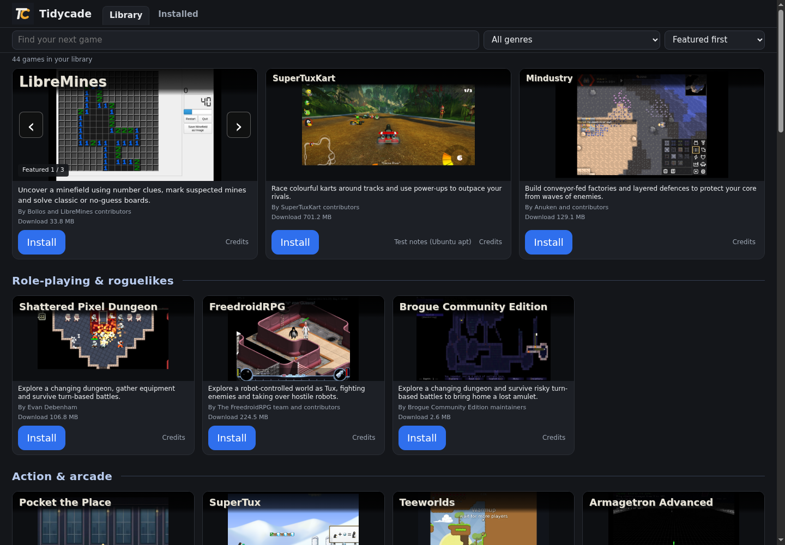
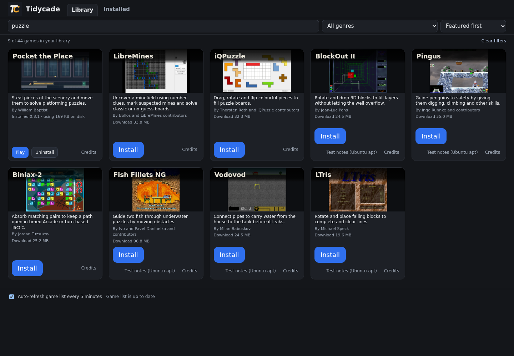
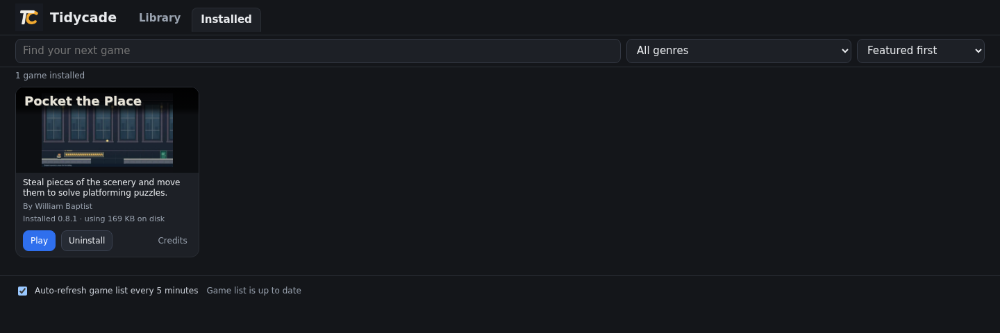

<h1> Tidycade</h1>

Browse a library of games. Install the ones you want, then press Play. Games download separately, so you don't need to download the whole collection.

*The Ubuntu preview after a game-list refresh. Screenshots below are from the same running launcher, not mock-ups.*

## Choose your download

| Computer | Download | Release status |
| --- | --- | --- |
| Ubuntu, 64-bit Intel/AMD | **[Ubuntu Preview 8](https://github.com/BaptistSec/Tidycade/releases/download/v0.11.0-preview8/tidycade-0.11.0-preview8-ubuntu-x86_64.tar.gz)** | Latest Ubuntu preview. 25 built-in games; 47 distinct choices after the checked game-list refresh. [Checks and limits](https://github.com/BaptistSec/Tidycade/releases/tag/v0.11.0-preview8). |
| Windows, 64-bit Intel/AMD | **[Windows Test 14](https://github.com/BaptistSec/Tidycade/releases/download/windows-test-14/tidycade-windows-test-14.zip)** | Separate test release with 14 games. Not the full Ubuntu library. [Checks and limits](https://github.com/BaptistSec/Tidycade/releases/tag/windows-test-14). |

These are previews/test releases, not a stable release. No macOS, phone or ARM download is available here. Windows testing used Wine, not native Windows.

Use the named downloads above. GitHub's automatic **Source code** archives contain this downloads repository, not the ready-to-run launcher. Developers can use the separately named source edition below.

## From download to Play

1. Extract the **whole archive** to a writable folder. Don't run it inside the archive viewer.
2. On Ubuntu, open `Tidycade-Ubuntu-0.11.0-preview8` and run `tidycade-ubuntu-x86_64`. Keep `THIRD_PARTY/` beside it. On Windows, run `Tidycade-Windows-TEST.exe` and keep its supplied files together. No Python installation is needed.
3. Tidycade opens in your default browser. Try **Pocket the Place**: Install, wait for the download, then Play.

On Ubuntu you may need Properties > Permissions > Allow executing. Don't run as root/administrator or bypass security warnings automatically. The unsigned Windows test may show an unknown-publisher warning; stop if unsure.

### Find something to play

Search by title, description or creator, narrow by genre, and sort by name or download size. Cards show the game before you install it. Credits and any linked test notes are beside the actions.

### Keep installed games together

Installed shows the games on this device, with Play and Uninstall. Preview 8 also counts available updates. Games update only when you choose Update.

Keep your existing `home/` folder beside the executable when changing launcher versions. It holds installed games, settings, cached lists and launcher-managed saves. Uninstall keeps launcher save folders. Native games may also save in their normal user folders; browser-game progress depends on the same browser profile and game address.

## Preview 8 changes

The official TC logo now appears in the launcher header and browser icon. Cards show saved data for the current package recipe and offer Resume install or Resume update. Saved bytes are not verified until the finished package passes its size and SHA-256 check; the server may still restart the transfer.

Interrupted package downloads keep their partial data. Choose Install again to attempt a resume; a server that ignores resume causes a fresh download. Every completed package must match its declared size and SHA-256 before installation.

Partials use disk space. Each component partial is bounded by its declared package size, but several game/content versions can accumulate. A successful install or uninstall clears that game's partial directory. There is no timed cleanup.

The Installed page now shows an updates-available count. The library keeps Preview 6's genre shelves, wrapping action rows and seventeen **Test notes (Ubuntu apt)** links. Those notes describe distribution-package tests, **not** the portable builds Tidycade installs.

[Release checks and known limits](https://github.com/BaptistSec/Tidycade/releases/tag/v0.11.0-preview8) cover the exact download. The resume change passed a local TLS fixture, including interrupted/cancelled transfers and bad responses. This is not a claim that every game, CDN, computer or full playthrough has been tested.

## Game lists, requirements and older versions

Preview 8 checks for catalogue updates at startup and can refresh every five minutes; the footer toggle controls this. The checked Ubuntu 22.04 x86-64 run exposed 47 distinct games after refresh. Device requirements can change what is offered. An offline first run has only the built-in list; later offline use keeps accepted cached additions. Internet is needed to install games. Offline play varies by game.

Third-party packages come from their official sources. Downloads can exceed 1 GB. Freeciv uses pinned Ubuntu jammy 2.6.6-1 packages with a documented portable setup/path patch, not the latest upstream release. Mindustry and SuperTux use small Tidycade setup components; SuperTux's compatibility libraries include notices and full source.

Running-game checks can prevent duplicate launches, updates and removal while a desktop game is detected. They are not universal: browser tabs, inaccessible processes and some externally launched interpreters are not covered. A terminal left inside a game folder can also keep it marked running. See the release notes for scope.

**Windows Test 14** offers Pocket the Place, OpenTTD, SuperTuxKart, Xonotic, OpenTyrian, OpenHV, Shattered Pixel Dungeon, VoxeLibre (with Luanti), Warzone 2100, Cataclysm: Bright Nights, The Powder Toy, Unciv, Mindustry and Teeworlds. Mindustry, Teeworlds, SuperTuxKart and Xonotic Windows execution remains unverified. Xonotic presents its own service terms. Audible audio, every hardware configuration and full playthroughs are unverified.

**Earlier Ubuntu 0.9.0 remains available:** [download](https://github.com/BaptistSec/Tidycade/releases/download/v0.9.0/tidycade-0.9.0-ubuntu-x86_64.tar.gz), [instructions](https://github.com/BaptistSec/Tidycade/releases/tag/v0.9.0). It has 23 built-in games and 25 after its older feed refresh. It does not upgrade itself to Preview 8 or receive the newer preview feed. Its interrupted downloads restart from the beginning.

[Preview 7](https://github.com/BaptistSec/Tidycade/releases/tag/v0.11.0-preview7), [Preview 6](https://github.com/BaptistSec/Tidycade/releases/tag/v0.11.0-preview6), [Preview 5](https://github.com/BaptistSec/Tidycade/releases/tag/v0.11.0-preview5) and [all earlier releases](https://github.com/BaptistSec/Tidycade/releases) remain available unchanged.

## Source and licences

[Download the Preview 8 developer source edition](https://github.com/BaptistSec/Tidycade/releases/download/v0.11.0-preview8/tidycade-0.11.0-preview8-source-edition.zip). Tidycade's own launcher code is MIT-licensed; see its `LICENSE` and `LICENSING.md`. It uses substitute title cards where the player binary retains game artwork, so it is not a byte-identical resource archive for that binary.

Games, artwork and brands keep their own licences. Screenshots on this page show mixed game artwork and are not blanket MIT assets. Each game card has Credits. Keep the notices supplied with your chosen download: `THIRD_PARTY/` in the Ubuntu preview, `attribution/` in Windows Test 14, and notices in downloaded games and cached additions.
