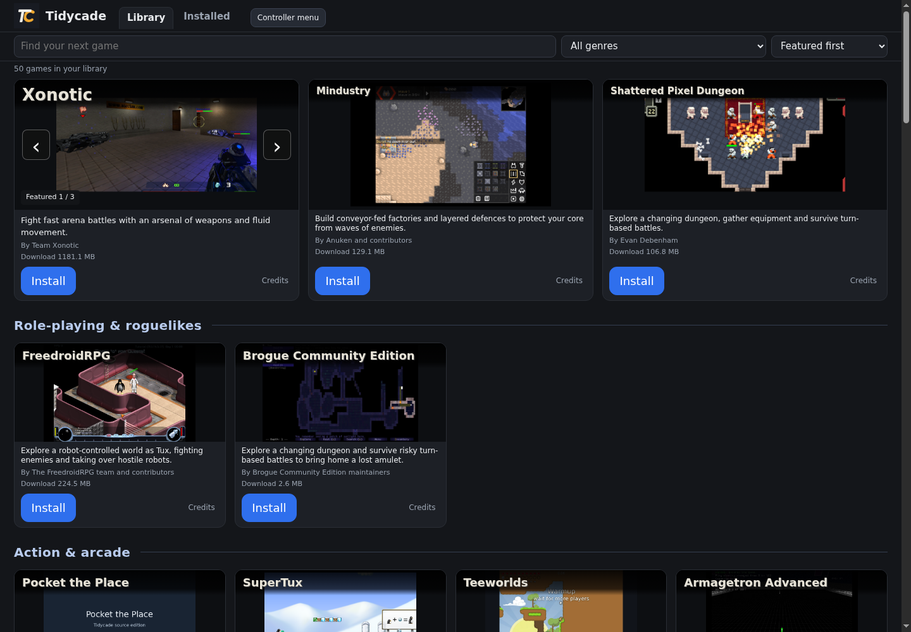
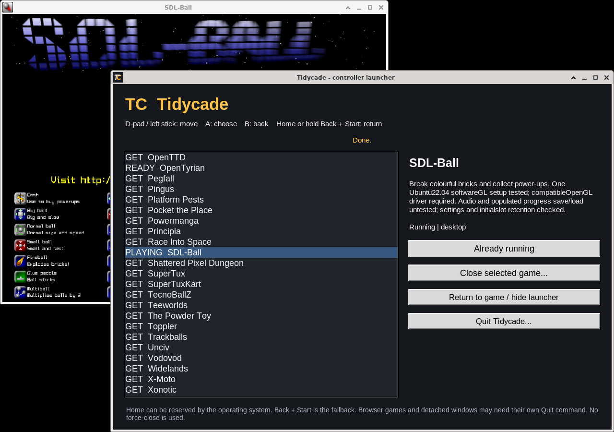
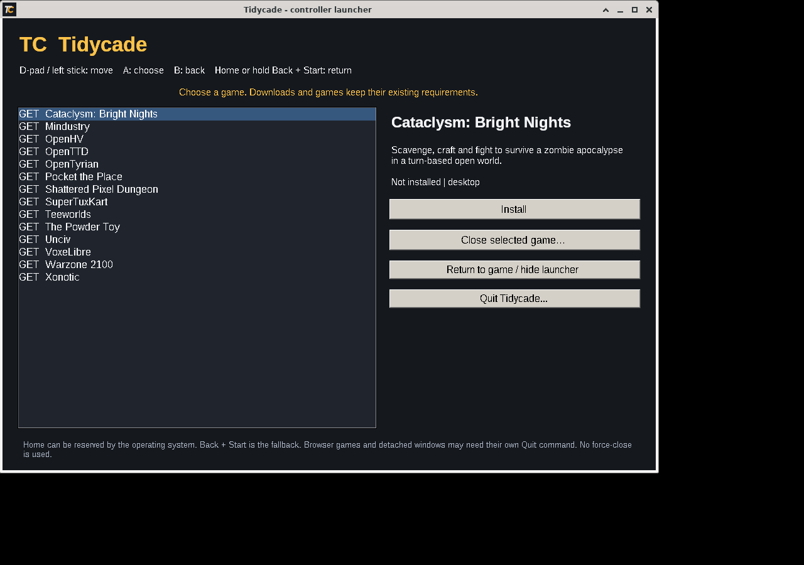

<h1> Tidycade</h1>

Browse free games. Install the ones you want, then play. Games download separately.

## Official 0.12.1 release

Windows and Ubuntu share the same launcher code, visual game-card interface, version and TC application icon. Native controller return and guarded game switching are now included alongside keyboard and mouse. Platform game availability still differs.

| Computer | Download | Current library |
| --- | --- | --- |
| Ubuntu x86-64 | [Tidycade 0.12.1 for Ubuntu](https://github.com/BaptistSec/Tidycade/releases/download/v0.12.1/tidycade-0.12.1-ubuntu-x86_64.tar.gz) | 50 games after the online refresh; 25 in the offline fallback |
| Windows x86-64 | [Tidycade 0.12.1 for Windows](https://github.com/BaptistSec/Tidycade/releases/download/v0.12.1/tidycade-0.12.1-windows-x86_64.zip) | The existing 14-game Windows catalogue |

[Official release](https://github.com/BaptistSec/Tidycade/releases/tag/v0.12.1) | [SHA-256 checksums](https://github.com/BaptistSec/Tidycade/releases/download/v0.12.1/SHA256SUMS) | [Matching application source](https://github.com/BaptistSec/Tidycade/releases/download/v0.12.1/tidycade-0.12.1-source.zip) | [SourceForge files](https://sourceforge.net/projects/tidycade/files/v0.12.1/)

The screenshots below show the unchanged 0.12.0 browser and controller-return interface. The 0.12.1 patch adds native download progress and cancellation.

These are actual running interfaces, not mock-ups. Artwork retains its own licenses. Controller input tests were virtual, not physical hardware; Windows checks were under Wine. Guide/Home may be reserved by the operating system. Unknown, detached, browser and unsupported windows are refused, not force-closed. This is not a universal controller-only path for every game.

## Patch update

0.12.1 adds live download size/stage to the native controller menu while an install is running. Its Install action becomes Cancel install, with Keep downloading selected by default. Back leaves the download running. Cancellation waits for the current step, keeps resumable partials and does not mean a completed install. A stale confirmation cannot cancel a different retry. The normal browser interface, catalogue and game recipes are unchanged.

## Play

Windows: extract the complete Windows ZIP into a folder you can write to, then open `tidycade-windows-x86_64.exe`. Ubuntu: extract the complete Ubuntu archive, then open `tidycade-ubuntu-x86_64`. Allow it to run as a program if your file manager asks. Python and the native controller-menu runtime are included. Keep the notices and other supplied files with the executable.

The normal launcher opens in your existing browser at http://localhost:8866/. Keyboard and mouse still work. Internet is needed for game downloads. Only one launcher can use the default ports. Do not run as root/administrator or bypass publisher/security warnings automatically. The Windows executable is unsigned.

Optional Ubuntu applications-menu entry: run `python3 install-desktop.py` from the extracted folder. It registers this copy and its TC icon for your user only, with no sudo. Run it again if you move the folder. Delete `~/.local/share/applications/tidycade.desktop` to remove the entry (or its equivalent under XDG_DATA_HOME).

## Keep your existing games and saves

While Tidycade is closed, keep its `home` folder beside the new executable when upgrading. It holds installs, settings, cached game lists and launcher-managed saves. Check the new copy before removing the old one. Games can also store saves in their normal user-data folders. Uninstall intentionally keeps launcher-managed saves.

## Controller navigation and return

A controller recognized by SDL's standard game-controller mapping can open the native Tidycade controller menu with its Guide/Home button. Where the operating system reserves that button, hold Back + Start together for about 0.8 seconds instead. No operating-system button binding is changed. Home/Guide capture is not guaranteed for every controller or system.

The controller menu stays hidden during normal startup, so the existing game-card browser remains the main launcher. A keyboard/mouse user can open the same menu with the browser's **Controller menu** button.

In the controller menu:

- D-pad or left stick moves. Left/right switches between the game list and actions; up/down moves within them.
- A chooses an action. From the game list, A moves to Install/Play; press A again to use it.
- B hides the menu and returns to the game, or cancels an open confirmation.
- To switch native games, return to the menu, select the running game and choose **Close selected game...**. Unsaved progress may be lost. The confirmation starts on Cancel. Move to Close game and press A only when ready, then wait for the game to exit before playing another game.

Closing is a normal window-close request, not forced termination. A game can show its own save/exit prompt or ignore it. Use B to hide the menu if you need to answer a game prompt, then return again. Unknown, externally launched, detached and unsupported windows are refused rather than guessed. Browser games and some terminal/Wayland/fullscreen games may need their own Quit command. A launcher restart can lose ownership of an already running game. This is not a universal controller-only workflow for every game, and it does not add controller support inside games.

Held input is blocked until released on return, focus changes and confirmations. Normal browser foreground controller navigation remains available for browser-recognized standard-layout pads: D-pad/left stick moves, A activates, B closes a credits dialog. Keyboard and mouse remain available throughout.

If the browser is closed while an owned game or the controller menu is active, Tidycade stays running so return still works. With no game and the controller menu hidden, closing the last launcher/game browser tab stops Tidycade after a short grace period. Quit Tidycade refuses to abandon a running native game or an active operation; close the game and wait for the operation first.

## Matched launcher, different game availability

The existing online catalogue has 50 Ubuntu and 14 Windows games on supported devices. The included offline fallback has 25 Ubuntu and 14 Windows games. Requirements filters can hide games. No new games or Windows recipes were added for this release. Search, shelves, downloads/resume, explicit updates, installed-game actions and saved-progress handling remain shared.

Pocket the Place and Platform Pests remain separate retained-rights games. Both official packages use original MIT text-only title cards for them instead of older retained-rights gameplay images. Other media and game launch recipes are unchanged.

## Verification and limits

The changed native-install path was checked in both frozen patch executables: Ubuntu directly and Windows under Wine. Actual keyboard events drove native Install, live progress, default Keep, Back, confirmed cancellation and retry against a controlled HTTPS transfer. Retry resumed at the saved byte offset, then passed size/hash checks and showed Installed/Play. Existing source checks cover stale-job refusal, unrelated-job isolation and busy-quit guards. These checks do not add physical-controller or native-Windows coverage. The wider 0.12.0 checks below remain prior-release evidence for unchanged paths, not new all-game checks.

Both packaged executables opened their real interface and native menu: Ubuntu directly, Windows under Wine, not on a native Windows desktop. Their 50/14 game lists, TC branding, source/interface match and normal browser shutdown were checked. Both default to a hidden controller menu and have a tested keyboard/mouse fallback.

The input bridge passed 27 pure and real-SDL virtual-controller tests against the exact bundled Ubuntu SDL 2.28.4 library. The pinned official Windows SDL 2.28.4 DLL also exercised the real-game controller cycle under Wine. Actual Ubuntu SDL-Ball and OpenTyrian, and Windows OpenTyrian and Teeworlds under Wine, exercised launch, background return, held-input protection, Cancel, normal close and switching using virtual controller inputs. Owned/unowned same-title windows and a disappearing X11 window were checked separately. These are not physical-controller tests, native-Windows hardware tests, or coverage of every game, device, audio setup, GPU or full playthrough.

Keep LICENSE, LICENSING.md, THIRD_PARTY and attribution notices. Tidycade's own code is MIT-licensed; runtimes, games and media retain their own terms. The separately named source archive matches the launcher code/media in these binaries and includes the native runtime provenance/build instructions. GitHub's automatic Source code archives describe the downloads repository, not that separately attached application source.

[Earlier releases](https://github.com/BaptistSec/Tidycade/releases) remain available unchanged. No automatic launcher-binary upgrade is claimed.
