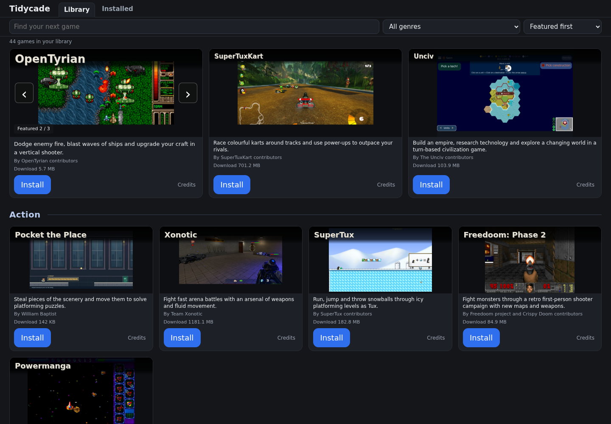

# Tidycade

A small games library: choose **Install**, then **Play**. Games download only when you choose them.

## Download Tidycade

Optional Ubuntu preview: [Tidycade 0.11 Preview 5](https://github.com/BaptistSec/Tidycade/releases/tag/v0.11.0-preview5) adds clear library connection errors and a retry button, while keeping the last loaded games visible after a failed refresh. It also retains running-game checks with the limits described on the release page. This is a separate preview download, not an automatic update or a replacement for the recommendations below.

| Your computer | Download | What you get |
| --- | --- | --- |
| **Ubuntu, 64-bit Intel/AMD** | **[Download Ubuntu 0.9.0](https://github.com/BaptistSec/Tidycade/releases/download/v0.9.0/tidycade-0.9.0-ubuntu-x86_64.tar.gz)** | 25 games after the small game-list update; 23 included offline. Portable preview. [Instructions and limits](https://github.com/BaptistSec/Tidycade/releases/tag/v0.9.0). |
| **Windows, 64-bit Intel/AMD** | **[Download Windows Test 14](https://github.com/BaptistSec/Tidycade/releases/download/windows-test-14/tidycade-windows-test-14.zip)** | 14 games available to install. Windows test release. [Test notes and limits](https://github.com/BaptistSec/Tidycade/releases/tag/windows-test-14). |

Neither download is for macOS, phones or ARM computers. The Windows download is a test, not the full Ubuntu library.

**Use the named downloads above, not GitHub's automatic "Source code" links.** Those contain this downloads page, not the ready-to-run program. The optional `.sha256` files are download-integrity checks, not programs.

## Open it and play your first game

1. Download the file for your computer, then **extract the whole archive** to a writable folder. Do not open the program from inside the ZIP/archive viewer.
2. On Ubuntu, open the extracted **`Tidycade-Ubuntu-0.9.0`** folder and double-click **`tidycade-ubuntu-x86_64`**. On Windows, open **`Tidycade-Windows-TEST.exe`**. Tidycade opens Library in your default browser. No Python installation is needed.
3. Try **Pocket the Place** first: choose **Install**, wait for it to finish, then **Play**. Other games work the same way. Installed games also have their own **Installed** page.

On Ubuntu, if needed, use Properties > Permissions to allow executing the program. Do not run as root/administrator or automatically bypass security warnings. The unsigned Windows test may show an unknown-publisher warning; stop if unsure.

This is extract-then-open, not a one-click installer. Keep all files supplied in your chosen download together. Windows Test 14 includes an `attribution/` folder; Ubuntu 0.9.0 embeds its bundled notices in the executable. Preview 5 also includes `THIRD_PARTY/`. Each game card has Credits, and downloaded games carry their own notices where applicable.

## What's new

- Upgrade to Ubuntu 0.9.0 once, keeping your existing `home/` folder beside the executable. Future qualified games arrive through small game-list updates, not another launcher download. Tidycade checks at startup; **Check for new games** checks again. Games still install only when you choose Install. A failed check keeps the last good list, with the included library and installed games available offline.
- 0 A.D. joins through the first separate game-list pack. Its game download is about 1.82 GB. Pegfall joins through the second pack, with keyboard menus and play; the same launcher adds it without another client download.

- LibreMines adds minesweeper boards and iQPuzzle adds geometric puzzles. Both use their official portable Ubuntu downloads.

- Lugaru HD adds martial-arts action and Principia adds physics-building adventures. Both use their official portable Ubuntu downloads.

- Larger, clearer genre headings and more space between sections make the library easier to scan. Selecting the featured tile with arrow keys returns the header and filters fully into view.

- Up and Down now move through the whole library, including out of and back into the featured section. On narrow screens they follow the single-column cards. Search, filters and open dialogs keep their normal arrow-key behavior.
- A full-width featured game and genre-based browse sections make the library easier to explore.
- Search titles, descriptions and creators, filter by genre, or sort by name and download size. Press Ctrl+K to jump to search.
- Hover or arrow-select a card for three-second gameplay previews. Featured rotation stays paused while you browse, then resumes 15 seconds after leaving, three seconds after Install or six seconds after Play.
- Armagetron Advanced, FreedroidRPG and X-Moto join Ubuntu. Freeciv remains on Ubuntu and Unciv on both platforms. Unciv downloads its own bundled Java runtime and keeps settings and saves outside its removable install folder.
- Three featured games have previous/next arrows and focused left/right keyboard controls. Each manual change resets the six-second rotation timer.

Keep Tidycade running during downloads. Browser reloads keep the job while the program is running. Quitting Tidycade or rebooting interrupts downloads; they restart from the beginning. Installed games remain registered across launcher restarts. In-progress downloads and their temporary status do not resume after quitting; use Install again for an interrupted download.

### Which Ubuntu download?

The recommended Ubuntu 0.9.0 above includes 23 games and currently receives two additions through its older game-list feed, for 25 choices after a successful check. Its **Check for new games** button checks that feed again. It does not receive the newer preview feed or upgrade itself to Preview 5.

The optional Preview 5 includes 25 Ubuntu games. Its newer game-list feed currently contains 20 rows, one updating an existing game, so it is not "20 more games". On the checked Ubuntu 22.04 x86-64 environment, a successful refresh exposes 44 distinct games. Available choices depend on the package's device requirements. These counts are a snapshot of the current feeds, not a promise for every older client or computer. Preview 5 checks at startup and can auto-refresh every five minutes; the footer toggle controls that behavior. Installed games update only when you choose Update.

Both versions keep successfully installed games across launcher restarts. Keep the existing `home/` folder beside the executable when replacing a launcher. Internet is needed to download new games. Offline play depends on each installed game; this is not a full offline-play guarantee.

## Available games

**Ubuntu:** Pocket the Place, Platform Pests, OpenTTD, SuperTuxKart, Shattered Pixel Dungeon, Xonotic, Naev, OpenTyrian, Widelands, OpenHV, Mindustry, SuperTux, The Powder Toy, Freeciv, Unciv, Teeworlds, Armagetron Advanced, FreedroidRPG, X-Moto, Lugaru HD, Principia, LibreMines, iQPuzzle, 0 A.D. and Pegfall (after a successful game-list check).

**Windows Test 14:** Pocket the Place, OpenTTD, SuperTuxKart, Xonotic, OpenTyrian, OpenHV, Shattered Pixel Dungeon, VoxeLibre (with Luanti), Warzone 2100, Cataclysm: Bright Nights, The Powder Toy, Unciv, Mindustry and Teeworlds. This is a test release; see its download page for requirements and known issues.

Games need internet to install, and larger downloads can exceed 1 GB. Third-party game packages come from their official sources. Freeciv uses pinned Ubuntu jammy 2.6.6-1 packages with a documented portable setup/path patch, not the latest upstream Freeciv. Mindustry and SuperTux also use small Tidycade setup components, including SuperTux compatibility libraries with notices and full source. Hardware requirements and first-run prompts still apply. Offline support varies by game. Not every level or computer configuration has been tested.

Keep `home/` beside the program when updating. Uninstall keeps launcher save folders. Browser-game progress depends on the same browser profile and game address. Some native games also use their normal user folders for saves/settings.

Armagetron Advanced was checked in a local bot match, FreedroidRPG in tutorial dialogue and movement, and X-Moto in tutorial riding. Full campaigns, Freedroid combat, restart/save behavior and audible audio are unverified. X-Moto's optional Internet prompt is for you to decide.

## Licence

Tidycade's own launcher code is MIT-licensed; see `LICENSE` and `LICENSING.md` in the source edition archive attached to [release v0.11.0-preview5](https://github.com/BaptistSec/Tidycade/releases/tag/v0.11.0-preview5). Games, artwork and brands keep their own licences; each game card's Credits has the details.

## Earlier downloads

Older releases and their files remain available unchanged: [Ubuntu 0.4.0](https://github.com/BaptistSec/Tidycade/releases/tag/v0.4.0), [Windows Test 2](https://github.com/BaptistSec/Tidycade/releases/tag/windows-test-2), and [all releases](https://github.com/BaptistSec/Tidycade/releases).

Existing Windows testing used Wine, not native Windows. Mindustry on Windows reuses the Ubuntu-loaded game and an official Windows Java runtime. Mindustry, Teeworlds, SuperTuxKart and Xonotic Windows execution is unverified. Xonotic presents its own service terms for you to review. SuperTuxKart uses the official portable Windows archive, about 880 MiB to download and 1.5 GiB extracted. Teeworlds on Ubuntu was checked against a local server, not public online servers. Audible audio, all hardware and full playthroughs are unverified.

Artwork credits and licences are available through Credits on each game card. Keep the notice files supplied with your chosen version: Windows Test 14 has `attribution/`, Ubuntu 0.9.0 embeds bundled notices in its executable, and Preview 5 includes `THIRD_PARTY/`. Downloaded game-list additions also keep their notices under `home/`.
