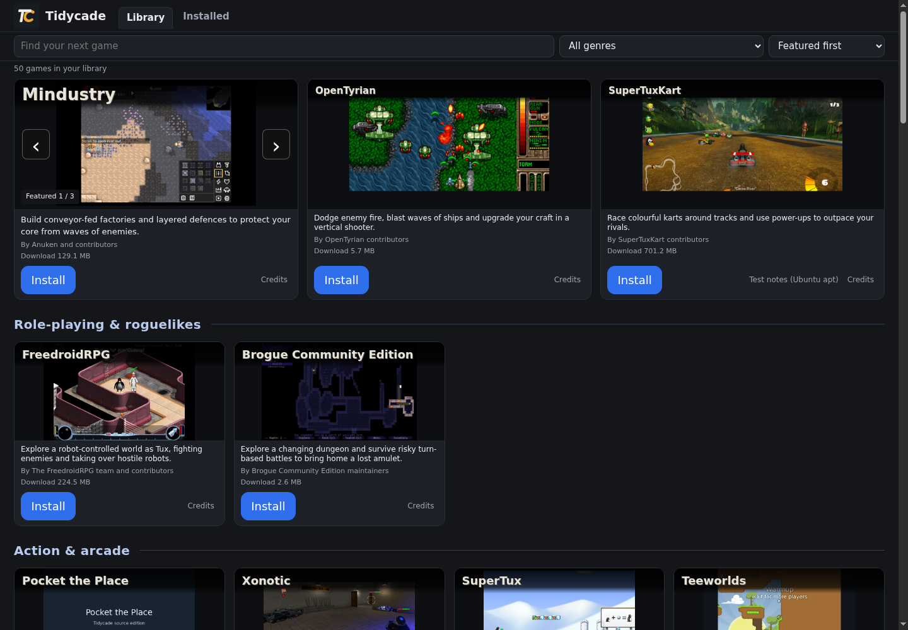
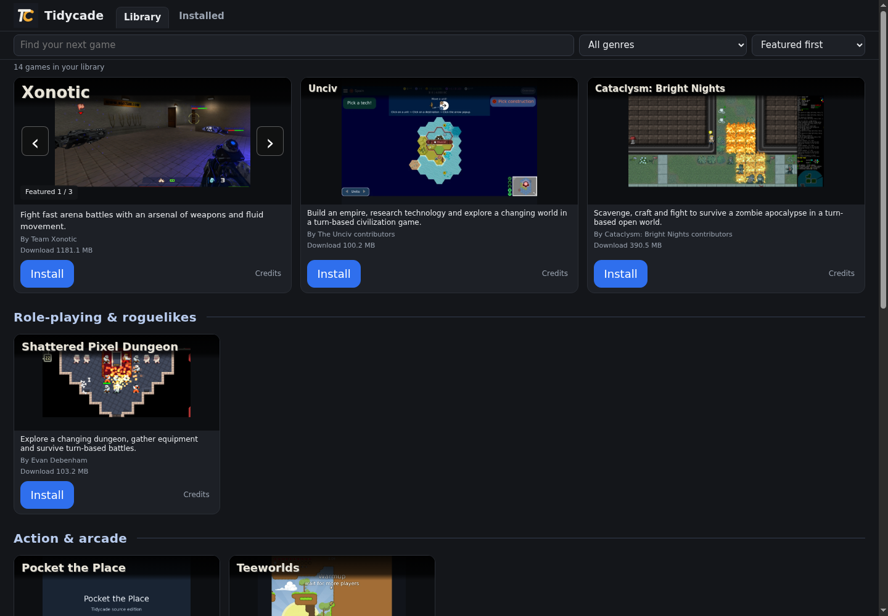

<h1> Tidycade</h1>

Browse free games. Install the ones you want, then play. Games download separately.

## Official 0.11.0 release

Windows and Ubuntu now use the same launcher code, interface and version. Both have the approved TC application icon. This is an official release, not a preview/test filename. Platform game availability still differs.

| Computer | Download | Current library |
| --- | --- | --- |
| Ubuntu x86-64 | [Tidycade 0.11.0 for Ubuntu](https://github.com/BaptistSec/Tidycade/releases/download/v0.11.0/tidycade-0.11.0-ubuntu-x86_64.tar.gz) | 50 games after the online game-list refresh on supported devices; 25 in the offline fallback |
| Windows x86-64 | [Tidycade 0.11.0 for Windows](https://github.com/BaptistSec/Tidycade/releases/download/v0.11.0/tidycade-0.11.0-windows-x86_64.zip) | The existing 14-game Windows catalogue, not the full Ubuntu library |

[Release instructions and known limits](https://github.com/BaptistSec/Tidycade/releases/tag/v0.11.0) · [SHA-256 checksums](https://github.com/BaptistSec/Tidycade/releases/download/v0.11.0/SHA256SUMS) · [Matching source archive](https://github.com/BaptistSec/Tidycade/releases/download/v0.11.0/tidycade-0.11.0-source.zip)

The Windows executable was checked under Wine, not on a native Windows desktop. Controller tests use simulated inputs, not physical hardware. No macOS, phone or ARM package is offered.

These are actual running launcher interfaces, not mock-ups. Game artwork retains its own licenses.

## From download to Play

1. Extract the whole archive into a folder you can write to.
2. Ubuntu: open Tidycade-Ubuntu-0.11.0 and run `tidycade-ubuntu-x86_64`. Windows: open Tidycade-Windows-0.11.0 and run `tidycade-windows-x86_64.exe`. Python is included. Keep the supplied notices and files together.
3. Tidycade opens in your browser. Choose a game, Install, wait for the download, then Play.

On Ubuntu you may need Properties > Permissions > Allow executing. Optional: `python3 install-desktop.py` adds this copy and its TC icon to your applications menu for your user only, with no sudo. Run it again if you move the folder.

Do not run as root/administrator or bypass security warnings automatically. The Windows executable is unsigned; stop if you are unsure about a publisher warning.

Keep `home/` beside the new executable when upgrading, while Tidycade is closed. It holds installs, settings, cached lists and launcher-managed saves. Check the new copy before removing the old one. Native games can also save in their normal user folders. Uninstall intentionally keeps launcher-managed saves.

## Shared launcher features

Search, genre shelves, featured previews, keyboard/mouse navigation, on-demand installs, explicit game updates, download progress and resume are shared across both systems. Accepted game-list updates arrive separately from launcher releases. Requirements filters can hide games on incompatible devices.

Interrupted downloads retain partial data and attempt a resume. Completed packages must still pass their declared size and SHA-256 checks. A server can require a fresh transfer. Partials use disk space; successful install/uninstall clears that game's partial directory, with no timed cleanup.

The Installed page counts available updates. Running-game guards help prevent duplicate launches, update and removal, but do not detect every detached, externally launched or browser game. Ubuntu-only apt test-note links are not shown as Windows evidence. Those notes concern distribution packages, not the portable builds Tidycade installs.

## Controller work, first stage

While the launcher page has focus, a browser-recognized standard-layout controller can use D-pad/left stick to move, A to activate and B to close a credits dialog. Keyboard and mouse still work. Navigation pauses when the page loses focus; held input must be released before it can act on return. Non-standard mappings are not guessed.

This release does **not** include Xbox/Home background return, a controller-only game-closing/switching workflow, or automatic in-game controller support. That native return-to-launcher work is separate and ongoing. No universal controller compatibility is claimed.

## Source, licenses and earlier releases

The separately named source ZIP matches the application code and media in both official executables. GitHub's automatic Source code archives contain this downloads repository instead. The launcher is MIT-licensed. Games, artwork, brands and runtime components retain their own licenses; keep LICENSE, LICENSING.md, THIRD_PARTY and attribution notices.

Pocket the Place and Platform Pests remain separate retained-rights games. Both official packages use the same original MIT text-only title cards for them instead of the retained-rights gameplay screenshots used in older player previews. Their game recipes are unchanged. Other media are unchanged.

[Earlier releases](https://github.com/BaptistSec/Tidycade/releases) remain available unchanged. No automatic launcher-binary upgrade is claimed. Internet is needed for game downloads; offline play depends on the game. Audio, GPUs, Windows game execution, every device and full playthroughs are not all verified.
